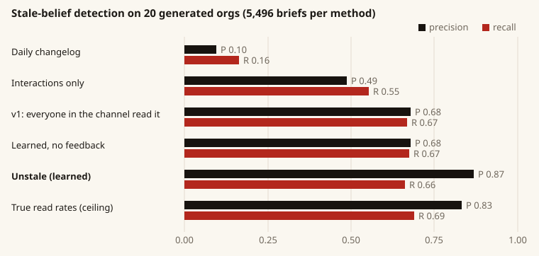

# Unstale

**Finds who is working from an old version of the truth.**

A deadline moves in a thread half the team wasn't in. A price changes in a channel sales doesn't
read. A support agent's knowledge base still says the old API is supported. A week later someone
quotes the old price to a customer.

Search, recaps and agent memory can tell you what is true now. Unstale tells you **what each person
and each agent believes**, how sure it is, and where that belief is out of date. It keeps two things in
one versioned graph on HydraDB:

1. **The facts, with their history.** Every fact ("Release 2.4 ships on...") is a versioned
   relation. A newer statement retires the older one and keeps it as history (SelfGraph).
2. **Who saw which version.** Every message is a node, and every person or agent who saw it has a
   `SAW` edge to it. What someone believes is the newest claim on a message they read.

The difference between the two is the product: a short list of exactly the things you are wrong
about, why you missed each one, and a check that stops you repeating them.

Built for the HydraDB Hackathon (Nov 14-16, 2026), Track 2: the context layer for agents. The hackathon's own
Track 2 video says it plainly: *"stale data is wrong data."* Every tool in the space works on what is true now.
Unstale works on who is still wrong, person by person and agent by agent.
Go-to-market: [docs/GTM.md](docs/GTM.md).

## Judge it in 60 seconds

Live, on the open-source HydraDB 0.4.0 engine: **https://unstale.onrender.com/app**. It is kept awake for judging
(`.github/workflows/keep-awake.yml`).

1. **60-second tour** (top bar) walks the whole product.
2. The brief opens on **Maya, Mon 29 Jun 08:00**: four things she believes that are no longer true, each with the
   message she got the old value from, the one that changed it, why she missed it, and how sure Unstale is.
3. **Click any fact chip.** The graph behind it: who saw which version, and the missing `SAW` edge that makes
   someone stale. Next to it, the five messages a real vector search returns for the same question. They're the
   right messages, but nothing in them says who read them.
4. **Fix it** on a card: who still needs to hear the change, which channel reaches them, who needs an @mention,
   a draft, and the corrections that would be left.
5. **Check before sending → Try: Maya's slack.** Her real message, one minute before she sent it: both outdated
   facts flagged, and the readers who would pick up the old values.
6. **Report** (top bar): what a RevOps lead gets from reading the team's history. Stale person-days, the changes
   that were missed, the channels they leak out of, who lags. Download it as Markdown.
7. **Proof** (top bar): every number in this README, read from the result files, with the command that makes it.
8. Your own agent: `claude mcp add --transport http unstale https://unstale.onrender.com/mcp`, then ask it what
   Tom still believes. A recorded session with the official MCP client: [docs/MCP_SESSION.md](docs/MCP_SESSION.md).

## The questions the judges asked, answered

The organisers' FAQ asks four things of the engineering. Each answer below points at the file that holds the number.

| Judging question | Answer | Evidence |
|---|---|---|
| **Right metrics:** did you measure what matters, not a vanity number? | Stale-belief **precision** (is each correction real? that is what decides whether anyone keeps it switched on), **recall** (of the facts people hold in an outdated version, how many we find), **false alarms per 100 briefs** (corrections about things the person already knew), and **LLM tokens per brief** (zero: a brief is a traversal). The outcome a manager pays for: **stale person-days removed** against that noise (below). The ground truth is hidden from the engine. | [eval/results.json](eval/results.json), [eval/BENCH-twin.md](eval/BENCH-twin.md) |
| **Continual learning over a baseline:** real improvement, not a one-off? | Baseline: the same engine with no learned evidence. On **40 orgs it never saw**, the same held-out sprint, scored after 0 to 4 earlier sprints of feedback: false alarms per 100 briefs 22.2 → **15.9** (paired change −6.3, 95% interval −8.9 to −3.6; 30 of 40 orgs improved), precision 0.82 → 0.86. **Control:** the same people answering the same corrections with coin-flip verdicts stays at 59.5 → 57.7 (change −1.8, interval −5.3 to +1.3: no real change). The learning comes from what people say, not from having more evidence. | [eval/curve-twin.json](eval/curve-twin.json) |
| **Impact of HydraDB and the graph:** would it fall apart on a plain store? | **Yes.** Take one piece of the graph away at a time (table below): without the who-saw-which-version edges you are left with a changelog, F1 0.12 and 105 false alarms per 100 briefs; a vector store over the same messages scores F1 0.13. | [below](#would-it-fall-apart-on-a-plain-store) |
| **Holds up under load?** | 20 concurrent users for 60 s against HydraDB 0.4.0 in Docker on a laptop, with "news to me" feedback written to the graph while it serves: **3,546 requests, 0 errors**, 59 per second, p50 208 ms, p95 1.0 s. | [eval/load.json](eval/load.json), `scripts/loadtest.py` |

## Would it fall apart on a plain store?

Remove one piece of the graph at a time (20 generated orgs, 5,210 messages, 5,496 briefs per row):

| What is left | F1 | False alarms per 100 briefs |
|---|---|---|
| **The whole graph**: versioned facts, `SAW` edges with strength, learned read evidence, who owns what | **0.75** | **6.8** |
| Without the learned `ReadEvidence` (every channel member is assumed to have read everything) | 0.67 | 21.4 |
| Without channel-membership `SAW` edges (only posts, replies, mentions and reactions count) | 0.52 | 39.3 |
| Without any `SAW` edges: a changelog of every change to the things you own | 0.12 | 105.5 |
| Without fact versions | nothing to compare: no outdated belief can be named | |
| No graph at all: a vector store over the same messages, plus an LLM (Northwind) | 0.13 | 18 told-what-they-knew in 16 briefs |

The answer needs three things at once: which version of a fact is current, who saw which version, and who is
responsible for what. A document or vector store holds the messages but none of those three relations.

The engine's pure-Python twin ([`unstale/reference.py`](unstale/reference.py)) is a **test oracle**, not an
alternative: it holds the same graph in dictionaries so the Cypher can be checked brief for brief (308 of 308
identical on 0.4.0). It rebuilds everything in memory on every run, with no persistence, no `as_of` reads and no
concurrent writers. It proves the traversals are right; it isn't a way to run the product.

## What it removes, and what it costs

The measure a manager buys is **stale person-days**: one person holding one outdated fact for one morning. If a person
acts on a correction the morning they get it, every later morning of that belief disappears. On the 20 generated orgs
(3,718 stale person-days), with the same orgs re-run at eight alert thresholds ([eval/frontier-twin.json](eval/frontier-twin.json),
`python scripts/bench.py --sweep`):

| Method | Stale person-days removed | False alarms per 100 briefs |
|---|---|---|
| Unstale, alert at 20% sure (most sensitive) | 84% | 26.9 |
| Unstale, alert at 30% sure | 78% | 14.4 |
| **Unstale, alert at 50% sure (default)** | **72%** | **6.8** |
| Unstale, alert at 90% sure (strictest) | 63% | 2.5 |
| Unstale v1: everyone in the channel is assumed to have read it | 72% | 21.4 |
| Daily changelog of changes in your scope | 95% | 105.5 |

Read it plainly. **A changelog reaches the most people, because it tells everyone, and that is exactly what makes it
useless:** 105 notifications per 100 briefs are about things the person already knew, and people stop reading them.
Unstale reaches 72% of the stale days with a fifteenth of the noise, and the learned read rates are what keep it there: the
v1 engine removes the same 72% at three times the false alarms. The rest is the honest ceiling: a belief that comes from a
channel message nobody can see was opened stays invisible to anything that only reads a Slack export. The assumption behind
all of it is that people act on a correction the same morning.

## Results at a glance

| | Result |
|---|---|
| Hand-written team (Northwind), LLM extraction | precision **1.00**, recall **0.92**, 0 LLM tokens per brief. The best LLM baseline reaches F1 0.38 at 3,188 tokens per brief |
| 20 generated orgs, 5,210 messages, reading the engine can't see | F1 **0.75** against 0.67 for the original engine; false alarms down **68%** (6.8 per 100 briefs vs 21.4; a daily changelog sends 105.5) |
| Learning from feedback | matches a model given the generator's **true hidden read rates** (F1 0.75 vs 0.75), and gets sharper with each sprint of evidence: 11.1 → 9.5 → 8.0 false alarms per 100 briefs on the same held-out sprint. On **40 further orgs it had never seen**, four sprints of evidence cut false alarms 22.2 → 15.9 per 100 briefs (paired change −6.3, 95% interval −8.9 to −3.6; 30 of 40 orgs improved). A control fed the same number of answers with coin-flip verdicts doesn't improve (59.5 → 57.7) |
| Does acting on it remove stale days? | At its default threshold Unstale removes **72%** of stale person-days at **6.8** false alarms per 100 briefs. The version that assumed everyone in a channel read it removes the same 72% at 21.4, three times the noise. The most sensitive setting removes 84% at 27. A daily changelog removes 95%, at 105.5 false alarms per 100 briefs |
| Messy wording | Every message rewritten casually, tersely and rambling, extractor unchanged: claim F1 0.94 to 0.95; the corrections keep precision 1.00 and lose recall only on terse and casual text (0.92 → 0.78 and 0.71) |
| Under load | 20 concurrent users, 60 s, feedback writes to HydraDB while serving: 3,546 requests, **0 errors**, p50 208 ms |
| Support agent answering customers | 29% correct from its own knowledge base; **94%** with Unstale's correction block added (+116 tokens), with **0** outdated answers. It fixes all 22 questions the knowledge base got wrong |
| HydraDB vs the Python twin | 168 of 168 briefs identical in the parity check on 0.3.0, and 308 of 308 on 0.4.0 (one org, seed 1); two full benchmark orgs (516 messages, three sprints each, feedback written to the graph) run on HydraDB reproduce the twin's numbers exactly |

## Try it

- **Live, on real HydraDB:** https://unstale.onrender.com (landing page; the app is at `/app`). A GitHub Action pings it
  every 10 minutes so it stays awake. Backup only: https://unstale.vercel.app runs the same code on SelfGraph's
  embedded Kuzu store, because Vercel can't run a HydraDB server, and says so in its top bar. Open the demo at `/app`, click **60-second tour**, or open **Proof**
  (every number, read from the result files) and **Pitch**. Click any fact chip to see **the graph behind it**: people, the messages
  they saw, the fact's versions, and the missing edge that makes someone stale.
- **One command, real HydraDB:** `docker build -t unstale . && docker run --rm -p 7860:7860 unstale`, then open
  http://localhost:7860. One container runs the open-source HydraDB 0.4.0 engine and the app, and rebuilds the graph at start
  from the committed extraction cache, so it needs no API key.

## What it does

- **Corrections brief.** "3 things Maya believes that are no longer true": the old value, the new
  value, the message she got the old one from, the message that changed it, why she missed it
  ("You're not in #release"), and **how sure Unstale is** (100% when she wrote it herself, lower when
  it only assumes she read a channel). Zero LLM tokens: it is a graph traversal.
- **Fix it.** Detecting is half of it. From the same graph and the learned read rates, Unstale says who still
  needs to hear a change, which channel reaches them, who needs an @mention because they rarely read it, and drafts
  the message. "Simulate sending this plan" re-runs the briefs over each person's real exposures plus the ones the plan
  would create, so you see the corrections that would be left. Nothing is written, so it is safe on a public demo.
- **Teach it what it missed.** Under the corrections: facts Unstale only *assumes* you read because you're in the
  channel. "I missed it" lowers your read rate for that channel (and, a little, everyone's) and Unstale starts
  suspecting people like you; "worth a check" shows candidates just under the alert threshold. This is how recall improves.
- **Connect your own agent.** The demo graph is a live MCP server at `/mcp` (streamable HTTP, read-only):
  `claude mcp add --transport http unstale https://unstale.onrender.com/mcp`. Tools: `corrections`, `who_to_notify`,
  `who_believes`, `check_before_sending`, `stale_report`, `give_feedback`.
- **Stale-belief report.** Replays every morning of a team's history and counts: stale person-days (one person
  holding one outdated fact for one day), which changes were missed and by whom, which channels changes leak out of
  (the share of each channel's changes that someone missed), who lags, and how many outdated beliefs nobody ever
  corrected. It is the document the audit-first pilot delivers on a team's last quarter of Slack export. In the app
  (**Report**), as Markdown (`/api/report.md`, a sample for Northwind in [docs/AUDIT_REPORT_NORTHWIND.md](docs/AUDIT_REPORT_NORTHWIND.md)),
  and as the MCP tool `stale_report`. Computed from the graph, no LLM.
- **Check before sending.** Paste a draft. Unstale flags any fact in it that has since changed
  ("ship date is Fri 3 Jul, not Mon 29 Jun; changed 26 Jun by Priya in #release; you never saw
  that change") and warns which readers still hold the old value.
- **It learns who reads what.** Every correction has "News to me / I knew this / Never heard of it".
  Each answer, and every echo or restatement people post on their own, is written to the graph as
  read evidence, and turns "channel member" from a guess into a learned read rate per person and
  channel. The graph gets sharper every run.
- **Echo detection.** When someone who missed a change repeats the old value, that is not a new
  version of the truth. Unstale classifies it as an *echo*: it doesn't overwrite the record, but it
  does mislead anyone who reads it and knew nothing better. Those people show up as stale too.
- **Agents are readers too.** An agent's context is the messages it read. The same layer gives an
  agent a correction block for its prompt, and an MCP server exposes it to any agent.
- **Runs on your Slack.** `python -m unstale.slack_import export.zip` reads a standard Slack export
  (users, channels, members, threads, mentions, reactions) into the same format.
- **Time travel.** Every read takes `as_of`, including what the graph had learned by then. Scrub the
  timeline and watch who falls out of the loop and when.

## Why a graph and not a vector store

Click any fact chip and the Graph view puts the two side by side: the graph of who saw which version, and the five
messages a real vector search returns for the same question (bge-small embeddings, `scripts/vector_demo.py`). The store
finds the right messages, old values included, and has no way to fill in "did Maya see it?"

A vector store can find messages that look related to "pricing". It cannot represent "Tom saw
version 1 of the price in #sales on 22 Jun and never saw version 2 in #pricing on 25 Jun", so it
cannot tell Tom from Lena, who made the change. The answer needs three things at once: versioned
facts, who-saw-what edges, and what each person is responsible for. That is a traversal.

```
(Person|Agent) -MEMBER_OF-> (Channel)
(Person|Agent) -OWNS | WORKS_ON | ATTENDS-> (subject)            what you are responsible for
(subject) -PART_OF | DEPENDS_ON | WANTS | USES | FOR-> (subject)  how work connects
(Person|Agent) -SAW {strength, ts}-> (Message) -ASSERTS-> (Claim {slot, value, kind}) -ABOUT-> (subject)
(subject) -SHIPS_ON | PRICED_AT | OWNED_BY | ...-> (value)         versioned truth, one current per slot
(Person) -LEARNED-> (ReadEvidence {channel, read, ts, source})     what the graph has learned about reading
```

"What might Maya believe?" is one two-hop query: `(maya)-[SAW]->(message)-[ASSERTS]->(claim)`.
"What is true?" is SelfGraph's version history for the slot. "Does Maya care?" is her
responsibilities plus one link (Maya owns Brightline; Brightline wants SSO; so SSO's release date
is hers to know).

## How sure is "Maya saw it"?

Slack doesn't say who read a message. Posting, replying, reacting, being mentioned or emailed is
**strong** exposure: they saw it. Being a channel member is **weak** exposure: maybe. The original
engine treated every weak exposure as read. Now ([`unstale/exposure.py`](unstale/exposure.py)):

- each weak exposure has a read probability, the learned read rate for that person and channel,
  partially pooled across the person's channels, the channel's members and the whole org (prior 0.8);
- for one fact, sort what the person may have seen from newest claim to oldest. They hold claim *k*
  if they read it and none of the newer ones: `P(k) = p_k * prod(1 - p_j for newer j)`. The chance
  they are stale is the sum over outdated claims, and that is the confidence shown on each card;
- evidence comes from three places, all stored as `ReadEvidence` nodes in HydraDB: feedback on a
  correction ("news to me" means every weak message with the new value went unread), **echoes**
  (repeating an outdated value shows the newer weak messages were missed) and **restatements**
  (repeating the current value after only weak exposure shows one was read).

With no evidence, every read rate sits at the prior and the decisions are exactly the original
engine's; evidence only moves the people whose behaviour says otherwise.

## Results

### Northwind: a hand-written team with an exact answer key

[`unstale/scenario.py`](unstale/scenario.py): 7 people and 1 AI support agent, 7 channels, emails and
DMs, 45 hand-written messages over 8 working days, with planted changes, a revert, a self-correction,
an echo, and one person who sits in a channel but never opens the message that matters. Every message
has a hidden answer key (its true claims, and who never actually read it). The engine never sees it.

Scored at 08:00 every morning plus the end of the scenario, for every person and the agent
(80 briefs). A hit is a (person, fact) pair the person is actually stale on.

| Method | Precision | Recall | F1 | LLM tokens per brief | Told people what they already knew |
|---|---|---|---|---|---|
| **Unstale** (LLM extraction, graph diff) | **1.00** | **0.92** | **0.96** | **0** | **0** |
| Unstale, strong signals only (ablation) | 0.77 | 0.51 | 0.62 | 0 | 11 |
| Org-wide LLM (every message + who is in which channel) | 0.39 | 0.36 | 0.38 | 3,188 | 9 |
| Vector RAG (top 8 messages + LLM) | 0.13 | 0.12 | 0.13 | 1,548 | 18 |
| Recap of the person's own channels (LLM) | 0.08 | 0.08 | 0.08 | 2,027 | 21 |

All LLM rows use the same model as extraction (`openai/gpt-oss-120b` on Groq), the same fact
catalog, and the same answer format, scored at two checkpoints (Mon 29 Jun 08:00 and the end: 16
briefs, 25 stale beliefs) to stay inside free-tier rate limits. At those two checkpoints alone
Unstale scores precision 1.00, recall 0.92 (23 of 25, no false alarms).

- **The recap** can only see the person's own channels, so it cannot know a price changed in
  `#pricing`. Most of what it lists are changes the person saw happen.
- **Vector RAG** finds messages about the right topics, but similarity has no idea who read which
  version, so it "warns" people about things they were part of.
- **The org-wide LLM** has strictly more information than Unstale and still lands at F1 0.38. Working
  out who saw what across 45 messages, then which version each person ended up with, is bookkeeping,
  and bookkeeping is what a graph is for.
- **Claim extraction** (Groq `openai/gpt-oss-120b`, fixed vocabulary): precision 1.00, recall 1.00 on
  the 39 annotated claims.
- **Unstale's misses are one honest case:** Dev sits in `#eng-payments` but never read Arjun's
  hand-off. No public signal reveals that.
- **Speed:** on a fresh HydraDB, ingest is 12 s for 45 messages (548 graph writes) and a brief takes
  about 50 ms.

### Benchmark: 20 generated orgs, hidden reading

Northwind is small, and its answer key follows the same rules as the engine, so a perfect score there
mostly proves the code matches the spec. The benchmark removes that advantage.
[`unstale/orgsim.py`](unstale/orgsim.py) generates software companies (9-13 people and a support
agent, 8 channels, three two-week sprints each) where release dates slip and come back, features move
releases, prices and refund windows change in #pricing, an API is deprecated then retired, an owner
hands over before leave. **Reading is latent**: every person has a hidden read rate per channel (high
for their team's channel, lower at the edge of their job, and some people lurk). People post what they
actually believe, so stale people produce real echoes, and colleagues who know better correct them in
threads. The engine sees only what a Slack export shows.

Every working morning every person and agent gets a brief; people answer 70% of their corrections
truthfully; that feedback is written to the graph and used from the next brief on.



| Method | Precision | Recall | F1 | False alarms per 100 briefs |
|---|---|---|---|---|
| **Unstale, learned exposure** | **0.87** | 0.66 | **0.75** | **6.8** |
| Unstale v1 (every channel member read everything) | 0.68 | 0.67 | 0.67 | 21.4 |
| Learned from echoes and restatements only, no feedback | 0.68 | 0.67 | 0.68 | 21.6 |
| Interactions only (strong signals) | 0.49 | 0.55 | 0.52 | 39.3 |
| Daily changelog of changes to things you own | 0.10 | 0.16 | 0.12 | 105.5 |
| Same model given the true hidden read rates (ceiling) | 0.83 | 0.69 | 0.75 | 9.4 |

20 orgs, 5,210 messages, 229 people and agents, 5,496 briefs per method
([full report](eval/BENCH-twin.md)).

- **Learning closes the gap to the ceiling.** The learned model scores the same F1 as a model handed
  the generator's secret read rates, with fewer false alarms.
- **Sharper every run.** Score the last sprint again with evidence from only the first *n* sprints:
  false alarms per 100 briefs fall 11.1 → 9.5 → 8.0 and precision rises 0.86 → 0.87 → 0.89.
- **Calibrated.** Of the candidates it scored 90-100% likely stale, 95% were; of those under 10%,
  11% were.
- **Feedback is what teaches it.** Echoes and restatements alone barely move it (F1 0.68); people's
  answers to their own corrections are the signal.
- **Recall is the honest limit.** About a third of stale beliefs come from a channel message the
  person never opened, with nothing observable to say so. No method that only sees a Slack export
  finds those: even the ceiling's recall is 0.69. Read receipts or an agent's context log would close it.
- **A changelog is not a fix.** Telling everyone about every change to their area sends 105 false
  alarms per 100 briefs and still misses most stale beliefs, because it can't tell who was in the room.

### Does it really run on HydraDB?

Every rule above exists twice: in the engine, as Cypher traversals over SelfGraph-versioned facts on
HydraDB, and in a Python twin ([`unstale/reference.py`](unstale/reference.py)) that holds the same graph
in dictionaries. `scripts/bench.py --hydradb --parity 2` checks that they agree: **168 of 168 briefs
identical**, and the same read evidence. Running the full benchmark loop on HydraDB itself, with every
person's feedback written to the graph as `ReadEvidence` as it goes, reproduces the twin per org:

| Org | Messages | Learned (HydraDB) | Learned (twin) | v1 F1 (both) | Ingest on HydraDB |
|---|---|---|---|---|---|
| 001 | 249 | P 0.93 R 0.85 F1 0.89 | P 0.93 R 0.85 F1 0.89 | 0.85 | 363 s |
| 002 | 267 | P 0.84 R 0.72 F1 0.78 | P 0.84 R 0.72 F1 0.78 | 0.65 | 535 s |

The twin runs all 20 orgs in about 30 seconds, which is why the 20-org table comes from it; on HydraDB
0.3 on a laptop each three-sprint org takes 15 to 20 minutes, most of it ingest. On a fresh instance
Northwind ingests in 12 s and a brief takes about 50 ms (80 briefs, 7 graph reads each).

### Agents: a support agent answering customers

A support agent reads its own knowledge-base channel; prices, refund windows and API status change
in channels it never reads. A customer asks about each fact it is responsible for, on Northwind (three
times) and four generated orgs: 31 questions, each answered under four context setups by the same
model (`openai/gpt-oss-120b`, [`scripts/agent_eval.py`](scripts/agent_eval.py)).

| Agent's context | Correct | Confidently outdated answers | Prompt tokens per answer | What the agent must be allowed to read |
|---|---|---|---|---|
| Its own knowledge base | 29% (9/31) | 10 | 429 | its own channel |
| **Own knowledge base + Unstale's correction block** | **94% (29/31)** | **0** | 545 | its own channel, plus a few facts |
| Every message in the org | 90% (28/31) | 2 | 3,156 | every channel |
| Vector RAG over every message (top 8) | 97% (30/31) | 0 | 544 | every channel, plus an index |

- **The knowledge base alone is confidently wrong.** 10 of 31 answers repeat a value that had already
  changed. On the 22 questions it gets wrong, Unstale's block fixes all 22; dumping every message
  fixes 19 at 5.8 times the tokens and still repeats two old values.
- **Vector RAG over the whole org does as well here, and we say so.** These are single facts with
  explicit change messages ("Update: Team plan price is now $45"), the best case for similarity
  search. The difference is access: RAG needs the support bot to index #pricing, #eng and every other
  internal channel, while Unstale hands it only the current value of the facts it is responsible for,
  without the messages. And the block arrives before the question: the agent doesn't have to know
  what to search for.
- **Unstale's two misses** are the agent answering "unknown" for the annual refund window although its
  own knowledge base had it right; the correction about the *monthly* window seems to have made it
  doubt the annual one.

Full answers: [`eval/agent.json`](eval/agent.json).

## Live demo

The real-HydraDB deployment is this repo's [`Dockerfile`](Dockerfile): the open-source HydraDB 0.4.0 engine and the app in one
container, with the graph rebuilt at start from the dataset and the committed extraction cache. It runs on any host that takes a Dockerfile
(it needs about 130 MB of memory): choose a Docker runtime, a free instance, and this repo.

A second copy runs on Vercel, which is always up and loads instantly. Vercel cannot run a HydraDB server, so that copy runs the same engine on SelfGraph's
embedded Kuzu store (`UNSTALE_STORE=kuzu`); the app says so in its top bar. Same code, same traversals: Northwind scores precision 1.00,
recall 0.917 on both stores.

Public demos switch off sending, cap feedback (so visitors don't change each other's graph) and keep no state between restarts.
"Check before sending" needs a Groq key, so on the public demos only the preset drafts (cached) work.

## Run it

Needs Docker, Python 3.11+, and a Groq API key (free tier is enough). Every LLM reply this README
reports is cached in `data/cache/llm` and committed, so ingest, eval and the agent eval reproduce
without a key; the benchmark needs no LLM at all.

```bash
# 1. HydraDB (open-source engine, local-directory object store)
cd infra
python -c "import secrets; print(f'HYDRA_TOKEN={secrets.token_hex(24)}')" > .env
docker compose --env-file .env up -d
cd ..

# 2. Python env (SelfGraph is installed from GitHub main; the PyPI 0.1.0 release predates insert.facts)
python -m venv .venv && .venv/Scripts/pip install -e ".[dev,baselines]"   # or .venv/bin/pip
echo "GROQ_API_KEY=..." > .env

# 3. Data, ingest, eval
python -m unstale.scenario           # writes data/northwind.json
python scripts/ingest.py             # LLM extraction -> HydraDB
python scripts/eval.py               # scores against the answer key
python scripts/baselines.py          # optional: LLM baselines (slow on free tier)
pytest -q                            # rules, exposure model, generator, Slack import

# 4. Benchmark and agent eval
python scripts/bench.py                         # 20 generated orgs x 3 sprints, Python twin (~30 s)
# Run the HydraDB benchmark on its own stack (see "Things we learned" below), then switch back:
cd infra && docker compose stop && UNSTALE_STACK=unstale-bench docker compose --env-file .env up -d && cd ..
python scripts/bench.py --hydradb --parity 2    # HydraDB and the twin must agree brief for brief
python scripts/bench.py --hydradb --orgs 2      # the benchmark itself on HydraDB (~35 min)
python scripts/agent_eval.py                    # support agent, 4 context setups (Groq)

# 5. Demo UI
uvicorn unstale.api:app --port 8765  # open http://localhost:8765
```

### On your own Slack

```bash
python -m unstale.slack_import export.zip --catalog examples/catalog.json -o data/myteam.json
python scripts/ingest.py --dataset data/myteam.json
UNSTALE_DATASET=data/myteam.json uvicorn unstale.api:app --port 8765
```

The catalog lists the subjects your facts are about (releases, plans, customers...), who owns what,
and how they connect; [`examples/catalog.json`](examples/catalog.json) is Northwind's.

### Use it from an agent (MCP)

With the API running:

```json
{
  "mcpServers": {
    "unstale": { "command": "python", "args": ["-m", "unstale.mcp_server"] }
  }
}
```

Tools: `corrections(person)`, `check_before_sending(author, text, channel?)`,
`who_believes(subject, attribute)`, `give_feedback(person, slot, verdict)`.

## Demo script

1. **Mon 29 Jun, 08:00, viewing as Maya.** Four corrections. The ship date moved to Friday and SSO
   slipped to 2.5, both in `#release`, which she is not in (100%: she wrote the old date herself).
   The price is 80%: Unstale assumes she read `#sales`, and says so.
2. **"Try: Maya's slack".** Her real 09:00 message, one minute before she sent it. Check before
   sending: both facts are flagged, and Tom and Lena are flagged as readers who would pick up the old
   values.
3. **Feedback.** "Never heard of it" on a card writes a read signal to HydraDB; her estimated read
   rate for that channel drops and the brief recomputes. The Team tab shows what the graph has learned.
4. **Support agent, end of scenario.** Its knowledge base says $39, 30-day refunds and "v1 is
   supported". All three changed in channels it doesn't read. The prompt block is what it should be
   told before it answers a customer.
5. **Click any fact chip.** The version history from SelfGraph, and everyone grouped by which
   version they hold.

## Built on HydraDB

- **HydraDB open-source engine v0.4.0** (Docker, pinned image `ghcr.io/hydra-db/hydradb:0.4.0`) holds the whole graph:
  directory, messages, claims, who-saw-what, fact versions and read evidence.
- **SelfGraph** (HydraDB's graph SDK) writes and versions the facts: each fact attribute is capped
  at one current value per subject (`max_count: 1`, `contradiction="supersede"`), so a newer update
  retires the older one with `invalidated_by` set, and the history stays readable.
- Raw Cypher on HydraDB does the traversals; a pure-Python twin ([`unstale/reference.py`](unstale/reference.py))
  holds the same rules in dictionaries and is checked against HydraDB brief for brief.

Things we learned about HydraDB while building (measured on 0.3.0; the Northwind result and tests were re-run on 0.4.0), in case they help others:

- SelfGraph's docs say its HydraDB store needs 0.4.0+. Unstale now runs on 0.4.0 (Northwind: precision 1.00,
  recall 0.917, about 82 ms per brief); the earlier work on 0.3.0 also worked, with SelfGraph installed from `main`.
- The 0.4.0 image runs as uid 10001, so the data volume must be owned by it. `infra/docker-compose.yml`
  does the `chown` in its init step; without it the node exits with "cannot create the shared disk cache directory".
- `WHERE r.is_current = true` on an edge costs about 110 ms per query; without it the same query
  takes about 20 ms. Directory edges are never retired, so Unstale leaves it out there.
- A two-hop pattern starting from a person (`(p)-[]->(s)-[]->(x)`) took about 1.5 s; the same
  lookups as one-hop seeks from known ids take milliseconds. `(s)<-[r]-(x)` was also about 9x faster
  than `(x)-[r]->(s)` for incoming edges.
- SelfGraph reserves the `evidence:` id prefix, and an entity's id prefix must match its type
  (`readevidence:` for `ReadEvidence`).
- **Keep heavy benchmarks off the demo instance.** After the benchmark wrote about 10,000 relations in
  thousands of small transactions into the same HydraDB, the demo's reads went from about 26 ms to
  about 400 ms each, across every namespace, and stayed there after a restart (the first query after
  restart hit the 30 s timeout while edge records reloaded). A fresh instance is back to 26 ms. The
  compose project name is now a variable (`UNSTALE_STACK`), so the benchmark gets its own stack.

## Limits, honestly

- **Exposure is estimated, not observed.** The learned model makes the guess calibrated and
  self-correcting, not certain. Stale beliefs that come from an unopened channel message with no
  trace stay invisible (recall 0.66 on the benchmark; 0.69 even with the true read rates).
- **The benchmark is our own simulator.** It is built to be hard in the ways real teams are (lurkers,
  leave, echoes, corrections, reverts), and the learned model was not tuned to it: its prior is 0.8
  while the generator's average read rate is about 0.6. It is still not real data; the Slack importer
  is the path to that.
- **Messy wording costs recall, not precision.** Every Northwind message was rewritten by a model in three styles (casual,
  terse, rambling) that keep every fact, and the unchanged extractor read them
  ([eval/robustness.json](eval/robustness.json), `python scripts/robustness.py`, then `scripts/robustness_e2e.py`).
  Claim extraction stays at F1 0.94 to 0.95 (precision 0.91 to 0.97, recall 0.92 to 0.97), against 1.00 as written. The
  corrections built on those claims keep **precision 1.00** in every style, and recall goes 0.92 as written, 0.92 rambling,
  **0.78 terse, 0.71 casual**: a terse "Use Payments API v1" or a casual "annual plans still 30" is where a fact gets dropped.
  Some of the misses are the rewrite drifting from the original facts, which counts against us. The dataset is still small,
  and the only way to know what your team's wording costs is to run it on your own export.
- **Facts must map to a vocabulary.** Unstale shows the LLM a fixed list of fact types per subject
  type. That is what makes two messages about the same fact land on the same node, and it is also a
  schema someone has to own. SelfGraph's ontology features are the natural next step.
- **Echo or revert?** When someone repeats an older value, Unstale calls it an echo unless they own
  the subject or certainly saw the current value. On ten three-sprint generated orgs this agrees with
  the answer key on 1,536 of 1,548 claims, and on all of Northwind's.
- **Effective dates.** "$49 from July 1" is treated as true when it is said, not on July 1.

## Layout

```
unstale/
  scenario.py     the Northwind team, messages and answer key
  orgsim.py       generated orgs with hidden read rates, for the benchmark
  rules.py        the problem definition: claims, echo, exposure, scope
  exposure.py     learned exposure: read rates, belief probabilities, evidence from feedback and echoes
  truth.py        ground-truth simulator (uses the hidden answer key)
  extract.py      message -> claims, with the fixed fact vocabulary (Groq)
  engine.py       the HydraDB / SelfGraph belief graph: ingest, exposure, diff, feedback, check
  reference.py    pure-Python twin of the engine, checked against HydraDB
  slack_import.py Slack export -> dataset
  api.py          FastAPI + demo UI (web/)
  mcp_server.py   MCP tools for agents
  report.py       the stale-belief report: stale person-days, missed changes, leaky channels, who lags
scripts/          ingest, eval, baselines, bench, agent_eval, extraction check
tests/            rules, exposure model, generator, Slack import round trip
docs/             go-to-market, demo script, benchmark chart
examples/         catalog for the Slack importer
infra/            docker compose for HydraDB
```

## License

MIT
